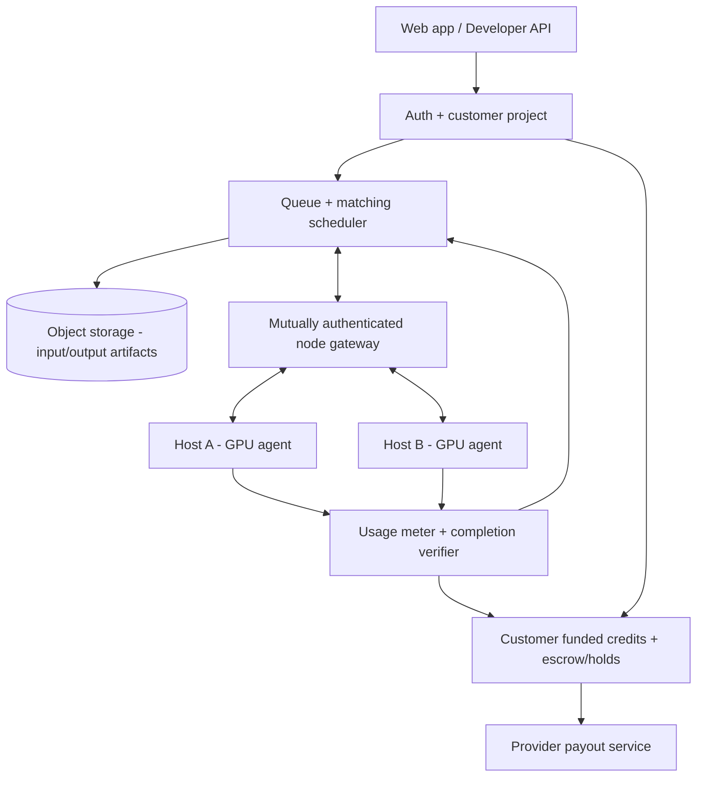

# Blockchain AI Shared-Compute
## Founders' Product Blueprint — direction B / v0.1

**Working product name:** SharedCompute. **Stage:** local proof of concept, not live service.
**Founding team:** William + Stefan.

## One-sentence pitch

SharedCompute is a marketplace that connects idle GPUs to paying AI workloads: hosts choose rates, developers submit jobs, the marketplace selects eligible capacity, and successful compute earns the host a payout.

## Non-goals for launch

- We are **not** distributing different layers of one foundation model across worldwide GPUs. That is a separate hard research problem.
- We are **not** launching a blockchain token, selling investments, or promising passive income.
- We are **not** guaranteeing confidentiality of sensitive customer prompts on third-party hardware.
- We are **not** claiming a fully decentralized scheduler at MVP. Start with a central reliable scheduler while the hardware network is permissionless to join.

## Three users

**Provider:** installs a small node agent, consents to GPU usage and resource caps, chooses availability and asking price, inspects completed-job records, and requests withdrawals after verified work. Must be able to stop or pause safely.

**Customer:** adds a funded credit balance, chooses a workload (initially supported batch inference/image tasks), minimum VRAM, max price, optional region, and receives outputs + itemized charges.

**Operator:** maintains the scheduler, billing ledger, proof-of-completion workflows, customer support, anti-abuse and safety policy, provider reputation, infrastructure and compliance.

## Recommended architecture for v0.2 / real two-node pilot

### Workload execution

1. Customer uses an authenticated API to submit an allowlisted workload and validated resources; compute credits are **reserved** rather than charged.
2. Scheduler checks real GPU availability, VRAM, memory headroom, runtime compatibility, recent heartbeats, price caps and estimated total cost. Jobs move `queued -> reserved -> running -> verifying -> completed/failed`.
3. Worker **initiates outbound** authenticated connection to gateway (supports NAT without opening inbound public ports), downloads signed and approved container image + input artifacts from time-limited signed URLs.
4. Worker runs job in a constrained sandbox with device/CPU/RAM/VRAM/time/network permissions and explicit provider resource limits. GPU passthrough is a host risk; isolate users and treat container isolation as insufficient against kernel/driver exploits.
5. Worker returns output artifact and metrics; verifier validates health and output checks. At first, support known tasks whose success is objectively checkable, not arbitrary customer commands.
6. Bill for verified execution, release reserved funds, credit provider internal ledger, and record immutable audit events. An operator can retry or refund.

### Initial control plane choices

- **API / orchestration:** Python + FastAPI or Go (both viable); durable jobs in PostgreSQL and a queue with acknowledgment + retries.
- **Provider agent:** signed Linux process; hardware discovery via NVML where supported, Docker/OCI execution via NVIDIA Container Toolkit, outbound mTLS or similarly authenticated persistent channel.
- **Data plane:** S3-compatible object storage with short-lived access and encryption, avoid routing big model weights or outputs through control plane.
- **Run policy:** start with limited workload templates, no customer arbitrary shells, no inbound ports and explicit safeguards against mining, attacks and illegal content.
- **Billing:** prefunded credits and atomic double-entry ledger; payment provider for deposits, payouts and refunds. Reconcile external provider webhooks and handle chargebacks.
- **Blockchain:** optionally settle aggregated provider payouts using an established stablecoin on a low-cost chain after compliance review. Do **not** record every GPU operation on chain.

## Matching algorithm: first real iteration

Eligible provider = `online AND healthy AND can_run(task) AND enough_free_VRAM AND regional_policy_OK AND estimated_total_cost <= budget`.

For eligible providers use weighted selection across asking price, observed reliability, recent completion rate, estimated start delay and latency to necessary artifacts. Start with price-first and apply caps to prevent cost blowouts; later estimate throughput rather than assuming RTX GPU-hour performance is equivalent between models.

## Unit economics / market design

MVP hypothesis: host sets a **GPU-hour asking price**; customer sees an all-in fixed estimate within a maximum budget; SharedCompute retains **10% of verified completed charges** and credits 90% to providers. This is a *proposal*, not a proven sustainable price.

| Example (illustrative) | Value |
|---|---:|
| Asking price | $0.60 / GPU-hour |
| Paid utilisation | 5 GPU-hours/day × 30 days |
| Customer job charges | $90/month |
| Host share, before power/costs | $81/month |
| Platform gross fee, before costs | $9/month |

**Platform margin risks:** payment fees, GPU-job verification, orchestration, egress/storage, refunds and chargebacks, support, malicious providers, idle supply acquisition. This is why deposits/payouts should be batched, and minimum billable task sizes may be necessary. Distinguish platform gross fees from profit.

**Host earnings risks:** electricity, GPU depreciation/wear, availability, utilization, tax and payout restrictions. The marketplace must never advertise guaranteed earning rates.

**Pricing discovery:** list test nodes in one region and compare all-in prices for equal performance on one narrow task (e.g. LLM batch inference or image generation). Time alone is a weak measure because GPU throughput differs; benchmark-based estimates should follow.

## Phases and exit criteria

**0 — This draft (completed):** offline UI, seeded listings, local host listing, simulated scheduling and queued jobs, simulated fee ledger and tests. No internet GPU network or real payments.

**1 — Two-host technical pilot:** two owned GPUs on different home networks; host-agent pairing; safe approved job template; real artifact in/out; job cancel/retry; actual utilization metrics; task success verified. A customer sees a real result, not a demo timer.

**2 — Closed beta marketplace:** small vetted provider cohort and developers; supported workloads only; reliable job state transitions; funded test credits (no payouts), refund handling and telemetry; operator console.

**3 — Paid marketplace:** compliance, customer billing, provider KYC where required, withdrawals, quality gating, abuse response, fraud controls, real support, price benchmarking and terms. Public launch only after security review.

**4 — Optional on-chain settlement:** deploy only if it reduces reconciliation, international payout friction or audit costs; consider stablecoin settlement for batched payouts rather than an unbacked speculative coin. Distinguish on-chain payouts from job execution.

## MVP validation questions to answer with real numbers

1. Can the same standardized workload run safely on a supported consumer GPU and return a correct result to the customer?
2. What is the effective useful throughput per GPU type, including cold-start and model-download latency?
3. How often do consumer nodes disconnect during useful work, and what is the retry cost?
4. Does total delivered compute cost beat alternatives at comparable reliability/performance?
5. At what utilisation does host electricity and wear make listing worthwhile?
6. Can verification and fraud controls remain inexpensive relative to a 10% commission?

## Role split to discuss

- **William:** initial product experience, marketplace front end, user onboarding, developer API and business model.
- **Stefan:** provider agent, GPU discovery/execution, runtime isolation and performance measurement.
- **Shared:** scheduler design, trust/security reviews, matching experiments, operations and go-to-market decisions.

This is a proposed division for discussion, not a fixed assignment.
