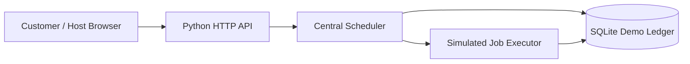

# SharedCompute — Founders' MVP Draft v0.1

A **working local simulation** of the proposed decentralized AI GPU marketplace by William and Stefan. Providers list GPUs, customers submit compute jobs, the scheduler matches eligible capacity, and the ledger records simulated payments.

**Everything operates locally. No real GPU jobs execute, no cryptocurrency or money moves, no accounts exist, and the seeded providers are fictional.** Do not put this demo on a public server.

## Run it

Requires **Python 3.9+**; no pip packages, cloud services, keys or blockchain wallets.

```bash
python3 server.py
```

On Windows: `py server.py`

Open **http://127.0.0.1:8765** in a browser.

The application saves its demo inventory and jobs to `sharedcompute.sqlite3` in this folder. The **Reset demo** link removes all custom inventory and jobs and restores 4 sample nodes. This database is omitted from the ZIP.

## Try the complete workflow

1. In **GPU marketplace**, browse the four fictional nodes (from 12GB to 48GB).
2. In **Host a GPU**, register a fictional node using your PC specifications, hourly price and region.
3. In **My jobs**, submit a compute request with workload type, required VRAM, estimated GPU-minutes, maximum USD spend and optional region.
4. The scheduler picks the cheapest online, idle GPU with enough VRAM and a total price within the spend cap; otherwise the job queues.
5. Complete the simulated job by pressing **Finish demo job**, or let the simulator finish it after 8 seconds. The provider receives 90% and the marketplace 10%, to the nearest cent, in *demo credits*.
6. Go to **Economics** to inspect the local ledger and example unit economics.
7. Take a node offline to see its in-progress job requeue, or add a matching node to unblock a queued job.

Note: A single provider runs only one demo job at a time; the scheduler auto-starts queued jobs when capacity becomes available.

## REST endpoints

| Method | Endpoint | Description |
|---|---|---|
| GET | `/api/health` | Local health check |
| GET | `/api/state` | Providers, jobs, and ledger totals |
| POST | `/api/providers` | Register self-reported GPU listing |
| POST | `/api/providers/{id}/toggle` | Toggle availability, requeue running work when disabling |
| POST | `/api/jobs` | Create a job, schedule if possible |
| POST | `/api/jobs/{id}/complete` | Force completion in demo mode |
| POST | `/api/reset` | Irreversibly reset all local demo data |

`POST /api/jobs` example:

```json
{
  "name": "Image generation batch",
  "task_type": "image",
  "min_vram_gb": 12,
  "minutes": 45,
  "max_budget_usd": "2.00",
  "region": "Any region"
}
```

`POST /api/providers` example:

```json
{
  "name": "Stefan's desktop",
  "gpu": "RTX 3060",
  "vram_gb": 12,
  "region": "Sydney, AU",
  "hourly_usd": "0.30"
}
```

## Architecture



This is a centrally coordinated **marketplace proof-of-concept**, not a trustless blockchain network. The future decentralized parts (independent node runner, secure execution, proofs/verification, deposit funding, crypto settlement) are explicitly *not implemented*.

## Economics (hypothesis)

- Provider sets GPU-hour listing price (USD); job customer price is `round(price × estimated GPU-minutes / 60, to cents)`, with $0.01 minimum.
- Customer only accrues a simulated charge upon completion.
- Provider demo payout is `round(charge × 90%, to cents)`; the platform receives the remainder.
- No charge for queued/failed work. Network/payment overhead, refunds, compliance, taxation and host power costs not included.
- An illustrative $0.60/GPU-hour node at 5 paid hours/day for 30 days results in $90 gross transactions, $81 provider credits, $9 gross platform fees — before costs, with demand/utilisation explicitly assumed.

## What v0.2 must add to handle real GPUs

1. Authenticated accounts, identity, roles and anti-abuse controls.
2. GPU host node agent with hardware discovery, signed heartbeats, connection management and graceful cancellation.
3. Isolated, policy-restricted containers/VMs and explicit user resource limits; don't run arbitrary remote code unrestricted.
4. Real task ingress (initially containerised batch inference or image jobs), object storage and output delivery.
5. Job timeouts, retry/requeue, job quotas, provider reliability and fraud-resistant completion verification.
6. Funded credits, secure payments, compliant settlement and refund logic. Stablecoin settlement only if useful and legally feasible; do not launch a token as the first step.
7. Production persistence, structured logs, metrics, security reviews and rate limiting.

### MVP acceptance test for a future *real* pilot

Two separately owned GPUs in different networks connect over the internet; one customer submits a sandboxed AI workload; the scheduler selects an appropriate machine; it completes and returns a verifiable result; provider metering records actual compute time; a funded test-credit ledger can reconcile the charge and fee. No crypto token necessary.

## Local tests

```bash
python3 -m unittest discover -s tests -v
```

## Security limits

This single-user local simulator has **no authentication, TLS, input attestation, sandboxed execution, payment processor, provider verification, rate limits, audit logging or multi-user isolation**. It intentionally binds to `127.0.0.1` only, never calls system commands, and never runs user-supplied GPU workloads. It must not be exposed to the public internet.
