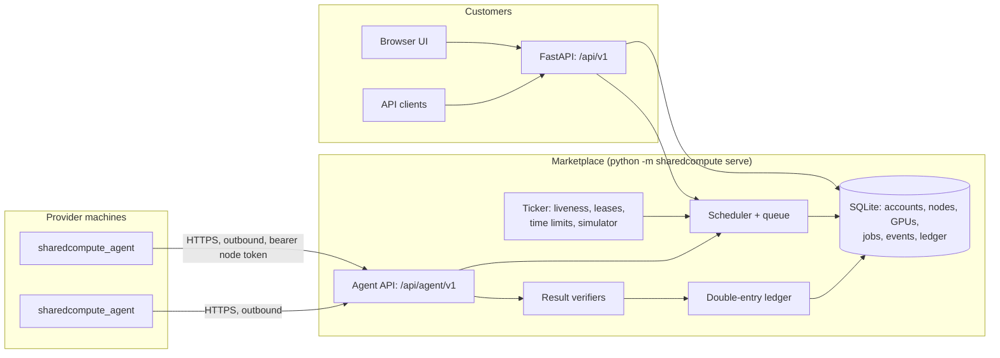

# SharedCompute architecture

How the v0.2 MVP is built, and the path from here to independently owned GPUs worldwide
running real customer workloads. Each section separates **what exists in this repository** from
**what is designed but not built**.

## 1. Principles

1. **Central coordination, independent hardware.** One marketplace API schedules and settles;
   GPUs belong to anyone who runs the agent. A decentralised scheduler is not a launch goal.
2. **Outbound-only providers.** Agents initiate every connection, so home GPUs behind NAT need no open ports.
3. **No customer code without isolation.** Until sandboxing exists, agents only run allowlisted
   templates whose output the server can verify.
4. **Bill only verified work.** Funds are held at submission, charged after a successful (and,
   where possible, verified) result, and released on failure or cancellation.
5. **Simulation is labelled, never implied.** Simulated listings and workloads are a separate
   execution path, tagged `SIM` in the UI and `execution: "simulated"` in the API.

## 2. Components



| Component | Where | Status |
|---|---|---|
| Marketplace API | `sharedcompute/api/` | Built. FastAPI; OpenAPI at `/api/docs`. |
| Scheduler and queue | `sharedcompute/services/scheduler.py` | Built. Runs on every relevant write plus a 1 s ticker. |
| Job lifecycle | `sharedcompute/services/jobs.py` | Built. |
| Ledger | `sharedcompute/services/ledger.py` | Built, simulated credits only. |
| Agent protocol (server) | `sharedcompute/services/agent_protocol.py` | Built. |
| Provider agent | `agent/sharedcompute_agent/` | Proof of concept, separately installable (`agent/pyproject.toml`, Python 3.8+). Standard library only; optional NVML. CUDA via ctypes against the driver. |
| Web UI | `sharedcompute/web/` | Built. No build step; ES modules; strict CSP. |
| Artifact storage, container runtime, payments | — | Designed below, not built. |

## 3. Data model

`sharedcompute/migrations/NNNN_*.sql` are the source of truth, applied in order on startup and tracked in
`PRAGMA user_version`. Never edit an applied migration; add the next number. All money is integer US cents.

- **users**: email + PBKDF2 password hash; `is_operator` for platform-wide views; `is_system` for the sample network owner (cannot sign in).
- **sessions**: SHA-256 of opaque bearer tokens (`scs_…`). The raw token lives only in the client's HttpOnly cookie.
- **nodes**: one machine. `kind` is `simulated` (self-reported listing, executed by the simulator) or `agent` (runs the agent). Agent nodes hold the SHA-256 of their `scn_…` token, the advertised workload capabilities, `max_concurrency` and `last_seen_at`.
- **gpus**: one compute device. `device_type` is `gpu` or `cpu` (a CPU device lets CPU-only machines take part).
  It holds the detection source (`self_reported`, `nvml`, `nvidia-smi`, `cuda`, `system_profiler`, `os`), the
  hashed hardware UUID, VRAM total and free, `cuda` (the CUDA driver opened it), compute capability, NVIDIA
  driver and CUDA driver-API versions, `display_active`, and per-device `capabilities` (workloads). It also has:
  - `offered`: the provider's opt-in on the machine; never scheduled without it;
  - `enabled`: the dashboard switch;
  - `present`: still reported by the agent;
  - the per-device price and the latest metrics.
- **jobs**: requirements (workload, min VRAM, optional min compute capability, estimated minutes, max budget, region), status, the assignment snapshot (device, node, provider, hourly rate, quote, fee bps, issued params, lease), and the settlement (billed seconds, cost, provider share, fee, result, verification, `executed_on`, `evidence`).
- **job_events**: append-only timeline; events carry `node_id` so node track records can be derived.
- **ledger_accounts / ledger_entries / ledger_postings**: double-entry bookkeeping. Every entry's postings sum to zero.

## 4. Job lifecycle

```
pending ──assign──▶ assigned ──start/claim──▶ running ──▶ completed
   ▲                    │                         │
   └───── requeue ◀─────┴──── interrupted ────────┤  retryable and attempts < max (3)
                                                  └──▶ failed
pending / assigned / running ──cancel──▶ cancelled
```

- **Interruptions** (attempt ends, job requeued): provider pauses a node or GPU, agent stops heartbeating
  (`node_ttl_seconds`, 30 s), agent fails to claim an assignment (`claim_timeout_seconds`, 90 s), GPU disappears
  from the agent's report, or the agent reports a retryable failure.
- **Final failures**: attempts exhausted, time limit exceeded (estimate + 60 s grace), result fails
  verification, non-retryable agent failure. No charge; the hold is released.
- **Simulated execution**: the ticker moves `assigned → running` and completes after `simulation_seconds`
  (8 s). Demo controls (`/demo/complete`, `/demo/fail`) exist only for simulated jobs.

## 5. Scheduling

Eligible GPU for a job: online (simulated nodes always; agent nodes by heartbeat), node and GPU enabled,
present, idle (no active job on the GPU; agent nodes also respect `max_concurrency`), supports the
workload (simulated ↔ simulated; agent workloads need the capability and, for CUDA workloads, a CUDA GPU),
VRAM ≥ requirement, region matches (or `any`), self-match allowed by policy, and
`quote = round(hourly × est_minutes / 60) ≤ max_budget`.

Ranking: lowest hourly price, then Laplace-smoothed node completion rate, then oldest listing. Jobs are
matched FIFO. `POST /api/v1/quotes` runs the same filters as a dry run and explains why a job would match,
queue, or never fit (no capacity, over budget).

Known limits: price-first ignores throughput differences between GPU models; no gang scheduling
(one GPU per job); FIFO can let a large unmatchable job sit at the head without blocking others (each job
is matched independently, so there is no head-of-line blocking, but also no fairness or priority).

## 6. Provider agent protocol

All endpoints are `POST /api/agent/v1/…` with `Authorization: Bearer scn_…`. The token is issued once
when the provider creates an agent node (or rotates it) and only its hash is stored.

| Call | Purpose |
|---|---|
| `hello` | Agent version, platform, `max_concurrency` and every detected device. For each device it sends `offered`, `offer_note` and the workloads it believes it can run. Devices are upserted by (type, hashed UUID) or (type, slot). The server keeps only allowlisted workloads matching the device type, and the scheduler re-checks hardware requirements itself. Devices no longer reported, or withdrawn, have their jobs requeued. Repeated every 10 minutes. |
| `heartbeat` | Every 10 s. Liveness + per-GPU utilisation, memory and temperature. Body lists the job ids the agent is running; the reply lists which to stop (cancelled, timed out or reassigned). |
| `jobs/claim` | Takes the oldest job assigned to this node: `assigned → running`. Returns the workload id, server-issued params, the device (type, slot, fingerprint) and the time limit. The agent re-checks the device locally before doing any work. |
| `jobs/{id}/complete` | Submits output. The server verifies it and records execution evidence (§7a). If both pass, it bills **server-measured** runtime (claim to completion) at the snapshotted rate, capped at the quote, and settles the ledger. The agent's own runtime figure is stored but not trusted. |
| `jobs/{id}/fail` | Reports an execution failure, with `retryable` to request a requeue. With `code: "incompatible"` it is a graceful rejection: the device stops advertising that workload until the next `hello`, and the job is requeued without using an attempt or counting against the provider. |

The agent (`python -m sharedcompute_agent run`) runs one job at a time in a worker thread, keeps
heartbeating during execution, enforces the time limit locally, backs off exponentially when the
marketplace is unreachable, exits on a revoked token, and on shutdown reports its running job as a
retryable failure.

### Hardware discovery and trust

Inventory: NVML (`nvidia-ml-py`) → `nvidia-smi` CSV (three query sets, newest first, for old drivers) →
macOS `system_profiler`. NVIDIA GPUs are then cross-checked with the CUDA driver itself (`cuInit`,
`cuDriverGetVersion`, compute capability, PCI bus id), matched by **PCI bus id** rather than index. Only GPUs
the driver opens are marked CUDA-usable. The CPU is reported as its own device.

**Opt-in (`agent/sharedcompute_agent/policy.py`):**
- No device is offered by default. GPUs need `--gpu INDEX|UUID` and the CPU needs `--offer-cpu`.
- A GPU with `display_active` is refused unless `--allow-display-gpu` is given, so a provider's main GPU is
  never used by accident.
- A selected GPU that cannot run any workload is reported as not offered, with the reason.

**Compatibility.** `agent.cuda_matmul` needs CUDA usable, compute capability ≥ 3.0, a CUDA 5.5+ driver and
64 MB VRAM. The agent checks this before offering, the server checks it again from the report (`workloads.incompatibilities`), and the
agent checks free VRAM again at claim time. Mismatches surface as quote explanations, dashboard notes or
graceful rejections, never as failed jobs.

Trust levels, lowest to highest:

1. **Self-reported listing** (simulated nodes): typed by a person.
2. **Agent-reported** (today): read from the driver or OS on the provider's machine. Accurate for honest
   providers but forgeable by a modified agent.
3. **Benchmarked** (next): the server issues verifiable workloads (the matmul checksum) and compares the
   timing against the claimed model's expected throughput.
4. **Attested** (later): signed agent builds plus hardware or TEE attestation where available (for example
   NVIDIA confidential computing on H100-class parts). Not applicable to most consumer GPUs.

## 7. Execution model

| Path | Runs where | Verified | Status |
|---|---|---|---|
| Simulated workloads (`sim.*`) | Nowhere; the server times them | No | Built, for testing the product |
| `agent.hashchain` | Provider CPU (a `cpu` device) | Yes, recomputed by the server | Built, verified end to end on a real machine |
| `agent.cuda_matmul` | Provider NVIDIA GPU via the CUDA driver API (ctypes) and PTX JIT | Exact checksum plus Merkle-committed result with challenged rows recomputed by the server | Built; tested with a fake driver; **not yet executed on NVIDIA hardware** |
| Customer containers | Provider GPU in a sandbox | Template-specific | Designed, not built |

### 7a. The GPU kernel and execution evidence

The kernel (`agent/kernels/matmul_i32.ll`) is LLVM IR compiled to PTX by LLVM's NVPTX backend
(`build_ptx.py`, reproducible in CI). The target is `sm_30` with PTX ISA 3.2, so the driver JIT-compiles the
same file for Kepler through current GPUs, and no CUDA toolkit is needed on providers. The workload multiplies
two seeded 256×256 int32 matrices (entries in [−8, 8], so int32 never overflows and results are exact on every
GPU), times `repeats` launches with CUDA events, and returns:

- `checksum = sum(C)`, which the server checks in O(n²) via `colsum(A)·rowsum(B)`;
- a Merkle root over all rows of C, and `samples` challenged rows with proofs. The rows are derived from
  `sha256(root ‖ server nonce)`, so they cannot be chosen before the whole result is committed. The server
  recomputes each challenged row exactly and checks its proof. A fabricated C that only satisfies the
  checksum fails.

The server then records where the job ran (`jobs.executed_on`, `jobs.evidence`):

| Level | Meaning | Billed |
|---|---|---|
| `gpu_attested` | Result verified. The agent reports GPU execution through `cuda-driver-ptx`. The reported device fingerprint and compute capability match the assigned GPU. Kernel time × repeats fits inside the server-observed window. | Yes |
| `cpu_fallback` | Result verified, but the agent reports CPU execution (only possible with `--allow-cpu-fallback`) | **No**: GPU workload |
| `inconsistent` | Identity or timing contradicts the assigned device | No |
| `failed_verification` | Wrong result | No |
| `cpu_verified` | CPU workload with a verified result | Yes |
| `simulated` | Simulator; nothing executed | Simulated credits |

`gpu_attested` is deliberately not called "proven". A modified agent could compute the matrix on a CPU and
claim otherwise. Proof of GPU execution would need benchmarked timing envelopes per GPU model, and
ultimately hardware attestation (§6).

### Designed: running real customer workloads safely

1. **Templates first.** Start with fixed images for objectively checkable jobs (batch inference with a
   pinned model, image generation with a fixed pipeline). Customers supply inputs and parameters, not code.
2. **Isolation.** Run each job in a gVisor or Kata container (or a Firecracker/cloud-hypervisor microVM with
   GPU passthrough) via the NVIDIA Container Toolkit, with no host mounts, a read-only root, CPU/RAM/VRAM
   and wall-clock limits, egress denied except to the artifact store, and a fresh environment per job.
   Plain Docker is not a sufficient boundary against kernel or driver exploits.
3. **Signed images.** Agents pull only images signed by SharedCompute (cosign), pinned by digest.
4. **Artifacts.** Inputs and outputs go through S3-compatible storage with short-lived pre-signed URLs, so
   large payloads never pass through the control plane. Encrypt at rest; delete after retention.
5. **Verification.** Per template: deterministic re-execution on a second provider for a sample of jobs,
   canary inputs with known outputs, and output schema checks. Disputes trigger a refund and provider strike.
6. **Provider safety.** Explicit consent and resource caps in the agent config, a kill switch, and an abuse
   policy (no mining, no attacks, no illegal content) enforced by templates and egress rules.

## 8. Accounting and settlement

Ledger entries (all simulated credits today):

| Entry | Postings |
|---|---|
| `demo_topup` | `platform:demo_funding −X`, `user:available +X` |
| `hold` (submission) | `user:available −B`, `user:held +B` |
| `charge` (completion) | `user:held −B`, `user:available +(B−C)`, `provider:earnings +P`, `platform:revenue +F` |
| `release` (failure/cancel) | `user:held −B`, `user:available +B` |

`C` (the cost) is never above the quote. `P = round_half_up(C × 90%)`, `F = C − P`, so the two parts always
sum to the charge and rounding ties favour providers. The fee rate is snapshotted per job, so changing
`SHAREDCOMPUTE_PLATFORM_FEE_BPS` never rewrites history. Tests assert after every scenario that the ledger
balances, no balance is negative, held funds equal the budgets of unfinished jobs, and platform revenue
equals the sum of job fees.

### Designed: real money

1. **Deposits** via a payment processor (Stripe or similar); webhooks post `deposit` entries. Credits are prepaid.
2. **Payouts** to providers in weekly batches via Stripe Connect or similar, with KYC where required, a minimum
   payout, and a holding period for dispute windows. Each payout is a ledger entry reconciled against the processor.
3. **Optional crypto settlement** (only after legal review): batched provider payouts in an established
   stablecoin (e.g. USDC) on a low-fee chain, recorded as ordinary ledger entries with the transaction hash.
   Job execution stays off-chain. No SharedCompute token.
4. **Before any of this**: move to PostgreSQL with serialisable transactions, make ledger rows immutable
   (corrections are new entries), and add reconciliation reports.

## 9. Security model

Built:

- Passwords hashed with PBKDF2-SHA256 (600k iterations); sessions and node tokens are random 256-bit
  values stored as SHA-256 hashes; session tokens in HttpOnly SameSite=Lax cookies (Secure behind TLS).
- CSRF: mutating `/api/v1` requests require `X-Requested-With: SharedCompute`. Cross-site forms cannot set
  it and CORS is never enabled, so cross-origin scripts cannot send it.
- Strict CSP (`script-src 'self'`, no inline script or style), `nosniff`, `frame-ancestors 'none'`.
- Ownership enforced in services: other users' jobs, nodes and GPUs return 404. Providers see neither
  customer identity nor job names. Platform economics require operator access.
- Input validation on every field, 64 KB body limit, login and registration rate limits (in-process).
- Agents can only advertise allowlisted workloads, only act on their own node's jobs, and cannot set their
  own billable time.
- Transport: agents refuse plain HTTP to non-loopback hosts and verify TLS (system store or `--ca-file`,
  TLS ≥ 1.2). `serve` refuses non-loopback binds without TLS or `--behind-tls-proxy`. Exposed servers mark
  cookies Secure, close self-registration, require sign-in for the marketplace and hide the API docs. See
  [REMOTE_CONNECTIVITY.md](REMOTE_CONNECTIVITY.md).

Not built (required before untrusted users):

- Email verification, password reset, 2FA for operators; mutual TLS or token binding for agents.
- Distributed rate limiting, audit logging, alerting, abuse reporting.
- Self-dealing controls: `SHAREDCOMPUTE_ALLOW_SELF_MATCH=0` once money is real.
- Signed agent releases and auto-update; mTLS or token-bound connections for agents.
- Security review and penetration test.

## 10. Scaling path

| Concern | Today | Next |
|---|---|---|
| Database | SQLite (WAL), one process, serialised writes | PostgreSQL; `SELECT … FOR UPDATE SKIP LOCKED` for assignment |
| Scheduler | In-process ticker | Dedicated worker(s) with leader election |
| Agent transport | HTTP polling (2 s claim, 10 s heartbeat) | WebSocket or gRPC stream through a gateway for push assignment |
| API instances | One | Several behind a load balancer; shared rate limiting (Redis) |
| Artifacts | None | S3-compatible storage with pre-signed URLs |

## 11. Milestones toward real GPU execution

1. **NVIDIA validation** ([HARDWARE_TESTING.md](HARDWARE_TESTING.md)). Run `diagnose --selftest` on one
   Linux machine with an older NVIDIA card, then a marketplace `agent.cuda_matmul` job reaching `gpu_attested`.
2. **Two-host pilot.** Two separately owned NVIDIA machines on different home networks connect to a
   TLS-fronted marketplace; jobs match, run, verify and settle; one host is unplugged mid-job and the job
   completes on the other.
3. **First real template.** A signed container for batch image generation or LLM inference, running under
   gVisor/Kata with artifacts in object storage and sampled re-execution for verification.
4. **Closed beta.** PostgreSQL, TLS, email verification, audit log, operator console, funded test credits
   (no payouts), provider onboarding with consent and caps.
5. **Paid marketplace.** Payment processor deposits, provider KYC and payouts, refunds and disputes, terms of
   service, security review.
6. **Optional stablecoin payouts**, only if they reduce cost or friction and pass legal review.
